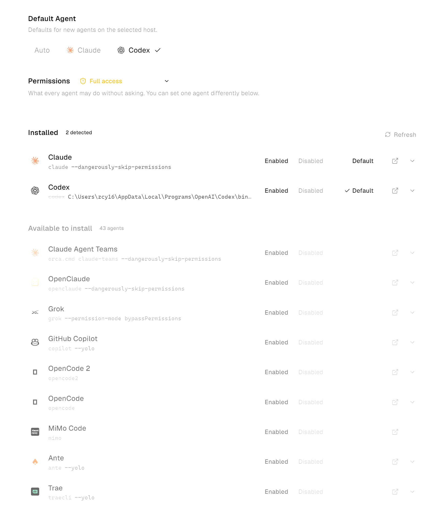
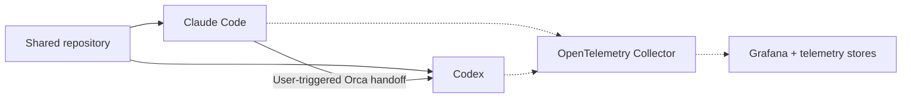

# Agent Dev Workbench

**Multi-agent workflows, continuity across harnesses, and visibility into execution.**

I'm building a development workbench that lets me move project work between coding
agents and understand the resources they use. It combines Orca's workspace and
handoff capabilities with a local OpenTelemetry probe and a Grafana integration
being developed and validated.

## Watch: Claude Code → Codex

The three-minute recording shows a **user-triggered native Orca handoff** in this
repository: work moves from Claude Code to a fresh Codex session, which inspects
the project and verifies the existing probe milestone.

**[▶ Watch the recording · 3 min MP4](docs/media/orca-handoff-1080p.mp4(1)?raw=1)**
· [Demo walkthrough and setup](docs/demos/orca-handoff.md)

*Preview: Orca's harness options. Claude Code and Codex are the two used here;
the other entries illustrate available choices.*

## Why the harness matters

Changing a model selects the engine an agent uses. Changing the **agent harness**
also changes the CLI, tool execution, configuration, and session managing the work.
In this setup, Claude Code and Codex use their separately authenticated accounts
and subscription allowances.

That gives me a practical resource management strategy: use available capacity
across existing subscriptions before turning to metered APIs or upgrading plans.
I can choose a harness for both its capabilities and the capacity available to me.

Continuity comes from two sources: **repository progress**—files, documentation,
and Git history—and **Orca-supplied context** from the preceding session. The
receiving agent checks the current workspace before continuing. The handoff
supplies context to a new session; it does not transfer complete internal session
state. See the [recorded handoff details](docs/demos/orca-handoff.md#what-carries-over).

## From workflow to observability

*Solid arrows show the demonstrated development workflow. The dotted telemetry
path is the integration under development and validation.*

The implemented [schema probe](probe/README.md) inspects telemetry before a
dashboard depends on it. The Grafana work aims to connect agent activity, model
round trips, token consumption, tool failures and latency, and execution traces
to a task spanning multiple sessions.

My engineering choices are to:

- **Reuse useful open-source infrastructure.** Adopt Orca for agent workflows and
  adapt Microsoft's hve-core local monitoring stack, concentrating this repository
  on integration, schema validation, and task-level visibility.
- **Validate before aggregating.** Check each harness's native telemetry schema,
  choose one token source per harness, and keep missing data visible.
- **Build privacy into capture.** Redact sensitive strings at probe ingest and
  keep captures out of Git. The design includes a local token budget set by the
  user, separate from provider subscription allowances.

## What comes from where

| Component | Contribution |
|---|---|
| [Orca](https://github.com/stablyai/orca) | Agent selection, terminals, worktree management, and native handoff with bounded context. |
| Claude Code and Codex | Their own agent runtimes, tools, authenticated accounts, and available allowances. |
| This repository | The Windows-friendly probe, synthetic fixtures, schema reports, workflow demonstration, and developing task attribution and Grafana integration. |
| OpenTelemetry, Grafana, and hve-core | Telemetry standards and reusable monitoring infrastructure; attribution is in [third-party notices](THIRD_PARTY_NOTICES.md). |

## Current status

| Milestone | Status |
|---|---|
| Cross-harness handoff | **Recorded:** Claude Code → Codex, context recovery, and repository verification. |
| Telemetry probe | **Implemented:** Python standard library receiver and PowerShell wrapper; **17/17 synthetic checks pass**. |
| Grafana integration | **Being developed and validated:** collector, storage, and dashboard integration. Real-session telemetry validation remains open. |

## Explore and run

- [Orca installation](https://www.onorca.dev/docs/install) and [demo setup / handoff walkthrough](docs/demos/orca-handoff.md#setup-and-operation).
- [Probe setup, capture, and schema reports](probe/README.md).
- [Monitoring architecture, data rules, and Grafana plan](docs/design.md).
- [Open-source attribution](THIRD_PARTY_NOTICES.md).
