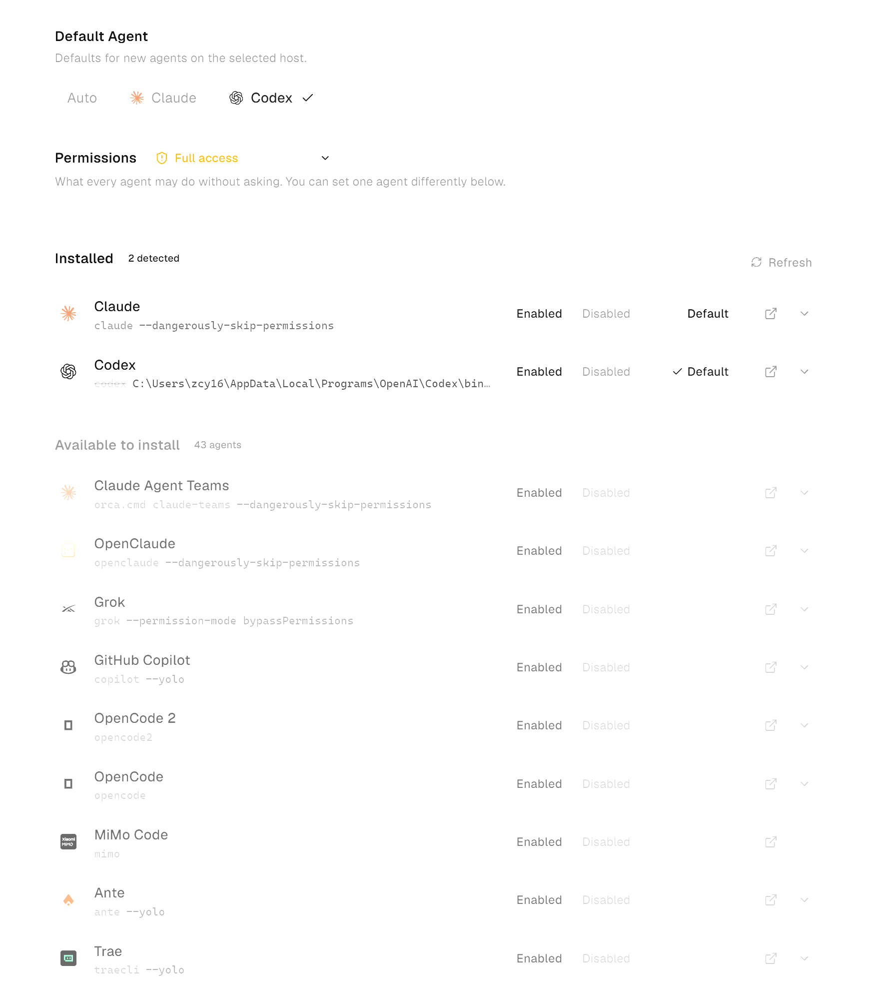
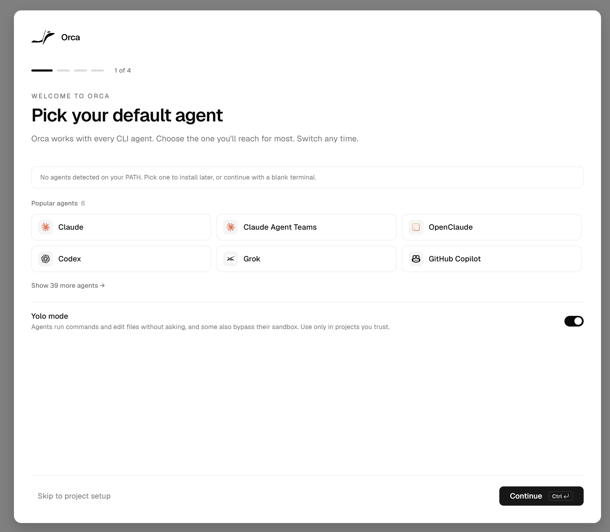
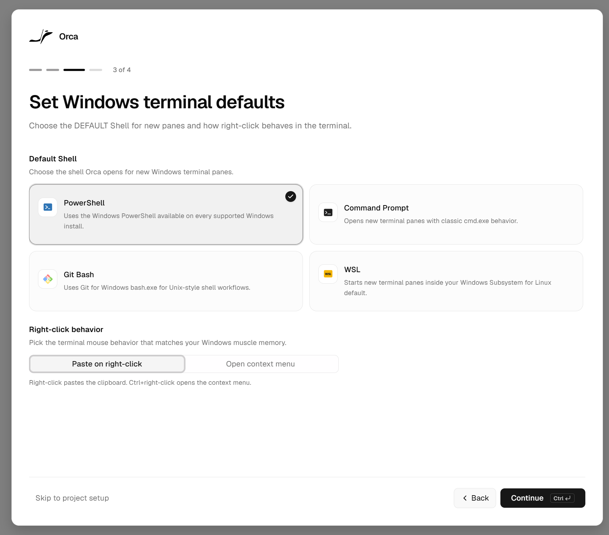
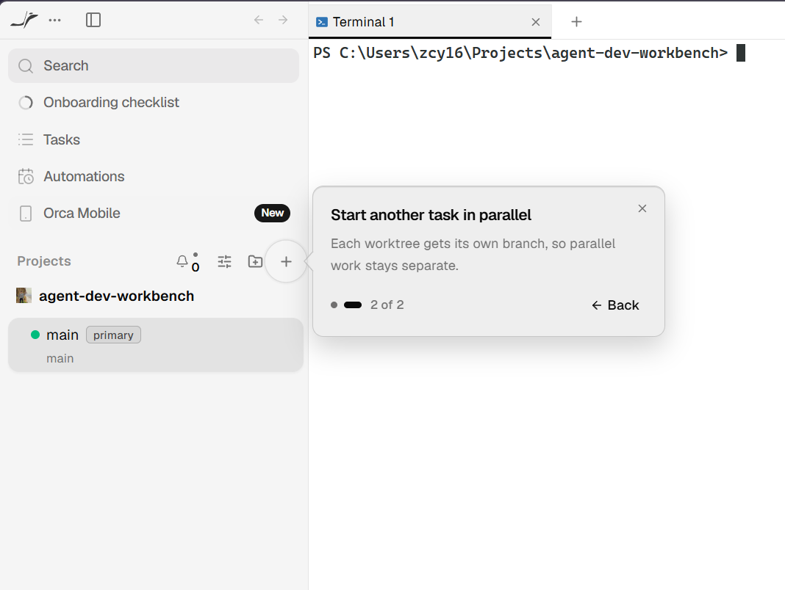
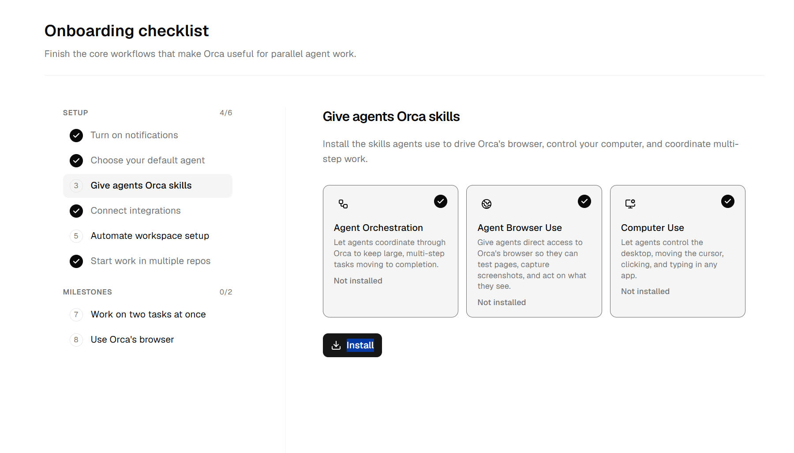

# Demo: a native Orca handoff from Claude Code to Codex

[← Project overview](../../README.md)

This demonstration moves an existing development task between two agent
harnesses in the same repository. I trigger Orca's native handoff from Claude
Code to Codex, using each harness's separately authenticated account and
subscription allowance.

**[▶ Watch the three-minute recording](../media/orca-handoff-1080p.mp4?raw=1)**

*Orca's configured harness list: Claude Code and Codex are installed. The
additional entries show options available to add, rather than agents used in
this demonstration.*

## What to look for

| Approximate point | Visible behavior | What it demonstrates |
|---|---|---|
| **0:20** | Orca's **Hand Off to Another Agent** dialog shows the original Claude session, a target-agent selector, and **Focused handoff** context. | The user initiates a native handoff tied to the current workspace. |
| **1:30** | A new Codex tab reads project documents while handoff context is being delivered; Orca reports that context was sent to the new session. | A different harness can inspect the same repository and recover the task's stopping point. |
| **2:45** | Codex reports the committed probe and passing synthetic checks, acknowledges the original session as read-only, and awaits the remaining context. | Continuation starts with verification of existing work and sufficient task instructions. |

The clip captures launch, context delivery, and repository verification. It ends
before implementation of the next milestone.

## What carries over

| Source | Role in continuity |
|---|---|
| **Repository** | Current files, design decisions, probe code, fixtures, and Git history provide durable project state. |
| **Orca handoff** | The original agent, pane, working directory, and bounded recent terminal capture orient the receiving agent. A saved transcript was unavailable in this run. |
| **User direction** | The next objective and ownership boundaries tell the receiving harness what work to undertake. |

Codex starts a new session and checks the workspace against the supplied context.
The original Claude session remains read-only context. This transfers a useful
working brief, not complete internal session state or the other harness's
authentication. Orca documents this behavior in its
[native handoff guide](https://www.onorca.dev/docs/agents/codex#hand-off-to-another-agent).

## Why I use this workflow

A model choice changes the engine within an agent. Here the boundary also includes
the agent's tools, configuration, authenticated account, and available allowance.
Moving between Claude Code and Codex lets me use capacity across subscriptions I
already have before adding metered API spend or upgrading a plan.

My contribution is integrating complementary tools into a repeatable development
workflow: use Orca's existing handoff, keep project knowledge in the repository,
verify the stopping point, and add observability to understand how the work runs.
The [OpenTelemetry and Grafana design](../design.md) complements that workflow
with task-level views of agent activity, token use, tool behavior, and execution.
The probe is implemented; the Grafana integration is being developed and validated.

## Setup and operation

1. Follow the [Orca installation guide](https://www.onorca.dev/docs/install).
   Install and sign in to the agent harnesses using their own accounts; Orca's
   [supported-agent documentation](https://www.onorca.dev/docs/agents/supported)
   links to the providers' installation instructions.
2. Open this repository in Orca. Configure the shell and confirm that Claude Code
   and Codex appear as installed agents. This demonstration uses Windows and
   PowerShell.
3. Work in Claude Code and leave a clear stopping point in the project files and
   session summary.
4. From the agent terminal's header or context menu, select **Hand Off to Another
   Agent**, choose **Codex**, and start the new session. The recording shows the
   **Focused handoff** option, which uses captured text and the current workspace.
5. Have the receiving agent inspect Git status and relevant files, reconcile them
   with the handoff context, and continue with an explicit next objective. Keep
   the original session as read-only reference.

For telemetry capture and operation, follow the
[probe guide](../../probe/README.md). The
[monitoring design](../design.md) describes the Grafana integration and its
validation requirements.

<strong>Setup gallery: agent choice, Windows shell, worktrees, and skills</strong>

These onboarding screenshots show Orca's configuration options. The configured
harness list at the top of this page shows the two agents used for the handoff.

| Agent selection | Windows shell selection |
|---|---|
|  |  |

| Parallel worktree option | Agent skills |
|---|---|
|  |  |

